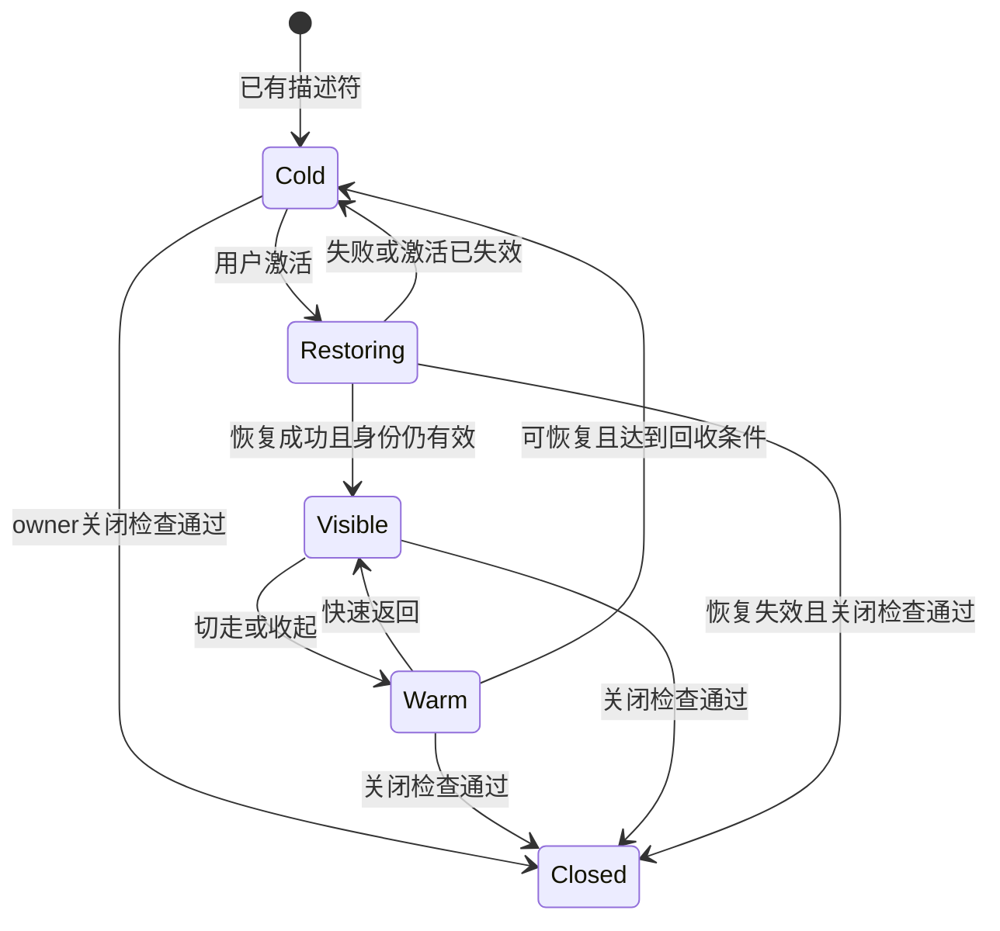

# 会话切换与工作台状态保留开发计划

- 日期：2026-10-17
- 状态：多 agent review 与架构收敛已完成；首批导航保留、文件树/代码/Markdown 恢复已实现并完成浏览器验收，其余阶段按下文顺序继续
- 适用范围：OpenSquilla WebUI 与 Windows Electron 客户端

OpenSquilla 应让用户在多个会话间切换后，继续使用原来的标签、阅读位置和输入草稿，同时让已提交的任务继续执行。实现这一体验，需要分别管理用户工作状态、后台业务状态和页面占用的资源。标签仍然存在，不应要求整个页面始终在内存中运行。

本计划扩展现有工作台与共享聊天实现：按会话保存轻量工作状态，复用现有任务、发送、审批和 side 生命周期，再按预算回收可重建的渲染器。主会话与 side 继续使用同一套聊天实现。

## 背景与实施前基线

用户录屏展示了两个问题：OpenSquilla 在切换 session 后，HTML 预览、工作区文件和终端标签消失，而辅助对话仍保留；作为交互参考的 Codex 在返回会话后，可以恢复原来的多个标签。目标是恢复工作连续性，同时避免随着访问的会话增多而累积 DOM、PDF worker、Office viewer、WebContents 和订阅。

当前已完成主与 side 共享聊天实现，以及面板布局、输入框密度、文件预览和部分交互一致性修复。本计划处理的是这些组件之上的状态归属与资源生命周期。

| 项目 | 已确认状态 |
| --- | --- |
| 代码基线 | 集成分支 `integration/shared-conversation-main-20261016`，提交 `f7e1da2b8` |
| main 同步 | 已 fetch 并执行 rebase，包含 `origin/main` 的 `3d6b8d012`，没有新增合并冲突 |
| 定向基线 | 工作台 store、runtime、聊天展示缓存共 3 组 92 项测试通过；该结果不是新保留机制的验收 |
| 新能力 | 全类型标签恢复、统一后台队列调度、统一资源预算尚未完成 |

现有测试包含“切换会话应删除文档标签”的断言。开发时必须先更新产品契约，再调整这些断言；保持旧测试通过不能证明新体验正确。

## 实施前行为与可复用基础

| 范围 | 当前行为 | 实施影响 |
| --- | --- | --- |
| 工作台导航 | `setSessionScope()` 关闭旧 session 中除 browser、assistant-chat 外的标签；外层执行关闭检查并清除文档、资源缓存 | 导航目前包含了关闭语义，需同时调整 store、外层装配和资源清理 |
| side 与 browser | 跨 session 保留挂载，主要通过隐藏组件切换显示 | 隐藏不会自动停止监听器、计时器、脚本和内存占用 |
| main 切换 | 释放旧 reader，恢复目标历史与实时状态；已被 Gateway 接受的任务不因普通切换而取消 | 可以继续沿用 reader 与执行分离的方向 |
| 展示缓存 | 已有最多 6 个 session、8 MiB 序列化内容、每个末尾 200 条消息的缓存 | 这是首屏展示缓存，不是实际 JS heap 或整个客户端的内存上限 |
| 待发队列 | main 切走后进入 parked 状态；隐藏 side 因组件仍运行，可能继续派发 | 队列行为受到视图是否常驻影响，需要单独统一 |
| 终端 | `TerminalPanel` 卸载会调用 close，后端结束 PTY | 不能直接将终端纳入普通预览淘汰策略 |
| 浏览器 | suspend 主要隐藏原生页面；当前没有覆盖全部 live 页面资源的统一预算 | 不能将隐藏、静音或关闭历史条数当作内存控制 |
| PDF 与 Office | 已有取消、销毁 viewer 或 worker 的路径，阅读状态多在组件本地 | 可复用资源清理，但要先补视图状态捕获与恢复 |

已有 app 级基础包括 durable delivery、全局会话状态、全局审批提醒、side owner 与续租，以及统一的 conversation lease、cursor 和 ACK 处理。新实现应复用这些能力，避免另建聊天事件 reducer、发送通道或原始事件缓存。

主要源码入口：

- [工作台 store](../../opensquilla-webui/src/workbench/store.ts) 与 [AppWorkbench](../../opensquilla-webui/src/components/workbench/AppWorkbench.vue)：scope 切换和关闭流程。
- [WorkbenchHost](../../opensquilla-webui/src/components/workbench/WorkbenchHost.vue) 与 [runtime manager](../../opensquilla-webui/src/workbench/runtime.ts)：组件挂载及非序列化资源管理。
- [会话运行层](../../opensquilla-webui/src/composables/chat/useChatSessionRuntime.ts) 与 [展示缓存](../../opensquilla-webui/src/composables/chat/useChatSessionViewCache.ts)：main 切换、快照展示和 reader 交接。
- [待发队列](../../opensquilla-webui/src/composables/chat/useChatPendingQueue.ts)、[durable delivery](../../opensquilla-webui/src/runtime/durableDelivery.ts) 与 [side owner](../../opensquilla-webui/src/modules/assistantChat.ts)：派发、回执和临时会话归属。
- [TerminalPanel](../../opensquilla-webui/src/components/workbench/TerminalPanel.vue) 与 [终端服务](../../src/opensquilla/gateway/terminal_sessions.py)：视图卸载和 PTY 生命周期。

## 产品行为边界

| 用户动作或系统动作 | 标签与视图状态 | 业务生命周期 |
| --- | --- | --- |
| A 切换到 B，再返回 A | 恢复 A 的标签顺序、活动项、展开偏好和阅读位置 | 已提交任务继续；不创建新的 side child 或上下文快照 |
| 收起右侧面板 | 标签保留，可暂停显示或回收可重建资源 | 不结束 side，不停止任务 |
| 内存预算触发回收 | 描述符与必要状态保留，下次访问按需恢复 | 不关闭 side、取消任务或结束 PTY |
| 用户显式关闭普通标签 | 执行该类型的关闭检查后移除标签 | 释放其资源；不顺带停止关联聊天任务 |
| 用户显式关闭 side | 按现有 closing、清理、closed 流程处理 | 结束对应临时 child，不影响父会话材料 |
| 刷新、退出或连接中断 | 普通标签跨刷新恢复不包含在首期承诺中 | 保持既有 side、Gateway、PTY 边界，不承诺自动续跑前端队列 |

首次交付保证同一应用运行期间的会话切换恢复。普通标签跨刷新或重启恢复应作为后续独立能力，恢复时重新解析资源和授权；side 不因引入持久存储而变成永久会话。

所有右侧面板遵守相同的导航规则。类型差异只体现在状态捕获、资源保护和恢复方式，不能继续使用“某种面板才允许跨会话保留”的显示白名单。

布局恢复保存用户的展开和宽度偏好，但按当前容器重新计算实际尺寸，继续遵守主会话优先与窄屏图标化规则。旧宽度不能导致恢复后的面板遮挡主会话。源码或预览模式恢复用户上次选择，不因资源重建被重置。

## 状态归属与恢复流程

### Review 结论与实施约束

2026-10-17 的 UX、资源和执行链三个独立 review 均认可状态与资源分离，但提出以下必须在实现中解决的问题。这些是设计风险，不代表已发生的生产故障。

| 优先级 | 风险与源码依据 | 实施要求 |
| --- | --- | --- |
| P1 | `useChatPendingQueue.switchPendingQueue` 等待旧重排 RPC；展示缓存同步 stringify/clone 可能阻塞导航 | 切换关键路径只做有界的轻状态记录与 owner 绑定，不等待网络、重实例 checkpoint 或完整历史序列化。旧请求仍由旧 owner 收尾，不能以跳过安全交接换取速度 |
| P1 | 终端有限日志尾部不能恢复光标、模式、alternate buffer；`xterm.write` 是异步消费 | 先保护现有终端实例；后续使用屏幕 checkpoint、连续序号增量和输出背压。保留连接断开清理契约，不把终端流控 ACK 混入聊天事件 ACK |
| P2 | 每标签 single-flight 不限制多个 PDF/Office 同时恢复的峰值 | 全局恢复排队与预算预约；计算 resident、restoring、disposing；当前选择与返回已有标签优先，取消尚未开始的过期恢复，并为前台返回保留容量 |
| P2 | 可见不等于拥有焦点；迟到恢复会抢走用户的滚动和输入位置 | 显式区分 visible 与 focused，复用现有 scrollEpoch/focus guard；用户交互后失效旧恢复，输入法组合与未保存编辑受到保护 |
| P2 | 停用全部恢复逻辑会使已经 Cold 的标签无法返回 | 导航保留、资源回收、后台队列分别控制；回退只停止新的回收，保留旧状态兼容恢复。调度回退先冻结派发、对账并交接唯一 owner |
| P3 阶段门槛 | `includeInitialHistory=false` 仍建立 live snapshot；App 单例不能防止双窗口派发 | 后台 owner 不持有完整 transcript，仅做必要有界权威检查；复用现有 lease/WAL/幂等，核实暂停代际、队列版本等服务端检查后才能启用后台自动派发 |

### 代码职责与改动边界

| 现有入口 | 改动职责 | 保留的边界 |
| --- | --- | --- |
| `workbench/store.ts` | 保存各 scope 的标签、活动项、展开与宽度偏好；切换只改变显示 | 显式关闭才删除标签；session/workspace/app scope 不混用 |
| `AppWorkbench.vue` / `WorkbenchHost.vue` | 导航移除 close/clearSession 路径，按驻留能力挂载视图 | 暂未支持安全恢复的 side、终端、浏览器保留原 owner，不因卸载改变业务 |
| `workbench/runtime.ts` / `types.ts` | 扩展现有 manager：实例 generation、轻量 view state、冷事件门控、全局恢复队列 | 不新增平行 manager；关闭 Cold 标签检查 owner，不为关闭重新加载重实例 |
| 各文件与预览 provider | 捕获模式、阅读锚点和 revision；恢复时重新读取并校验资源 | 不把 Blob、DOM、token、完整历史放进标签描述符；原授权不可切成当前 session |
| `conversationSessionRuntime.ts` 与 gateway adapter | 继续提供唯一 cursor/events/subscriptions 及消费契约 | 不新增后台 RPC listener、reducer 或 ACK 系统 |
| `useChatPendingQueue.ts` | 提取队列、暂停/重排门控、派发与 unknown receipt 为轻量业务 owner | DOM、自动高度、焦点与 UI 映射留在视图适配层；不能整体全局常驻 |
| `durableDelivery` / 全局审批中心 / `assistantChat*Owner` | 复用 WAL、回执恢复、审批提醒、side binding/续租及临时附件存储 | 全局摘要仅提示与唤醒，实际动作重新核验；主/side 注入不同 lifecycle/storage policy |

操作语义必须可区分：`switchScope` 只改变可见范围，`releaseView` 只释放可恢复实例，`closeItem` 才结束对应 owner。接口名称可随现有实现调整，但三种职责不得再合并到 scope watcher 或组件 unmount。

主/side 仍使用同一个 ChatView 与会话事件投影。后台控制器按业务需要创建和释放，不为每个曾访问或正在运行的会话保留整份聊天响应式对象。side 首次有效发送创建快照、临时性、显式关闭、刷新/退出边界保持不变。

### 四层状态

| 层次 | 持有的数据 | 释放条件 |
| --- | --- | --- |
| 会话工作状态 | 标签描述符、顺序、活动标签、面板偏好、文件模式、阅读锚点 | 显式关闭或独立的状态保留规则 |
| 业务 owner | 已提交任务、发送回执、队列、审批、side 续租、终端所有权 | 对应业务结束或显式关闭 |
| 展示缓存 | 最近消息、展开状态、缓存视图、滚动锚点 | 有界 LRU 淘汰；不影响业务 |
| 重资源实例 | DOM、编辑器、iframe、canvas、worker、WebContents、可重读 bytes | 不可见且满足安全回收条件时释放 |

扩展现有 `WorkbenchItem`、provider 和 `WorkbenchRuntimeManager`。保留现有 session、workspace、app scope，记录资源的实际 owner；工作区级共享工具不能隐式改成会话级，也不能通过缓存混用授权。

状态键至少区分 Gateway 与账户身份、workspace binding、所属 session 和 tab。资源状态另带 resource identity、revision 与 schema version。父工作台的展示归属和 child 的读取授权分别保存；恢复旧标签时不能改用当前正在显示的 session 授权。

描述符与轻量 view state 不存 DOM、WebContents handle、Blob URL、访问 token 或整份历史。草稿、附件与未保存编辑由独立 owner 持有，不能随展示缓存淘汰。

### 切换与返回

1. 同步固定离开会话的 scope、owner 与操作代际，记录有界的轻量阅读状态。草稿和未完成操作先明确归属；未完成的 RPC、WAL 和重资源 checkpoint 由旧 owner 继续处理，不挡住目标会话显示。
2. 更新当前可见 scope，及时隐藏旧原生 surface，显示目标会话的标签外壳。普通导航不再调用关闭检查。
3. 有可用缓存时先显示缓存内容；随后通过现有 history/live 协议恢复权威状态。缓存画面不直接恢复审批等操作权限。
4. 只恢复当前选中的重面板，其他标签保持轻量状态，避免一次性加载整个会话的全部文件。
5. 根据可见性、资源保护原因和预算，将旧实例保温或回收。

owner 交接尚未完成时，限制对应队列的派发，而不是冻结整个导航。异步回执只能更新原 scope。记录点击到目标外壳出现、到可交互两种耗时；测试旧 RPC 永不返回时目标会话仍可操作。

聊天阅读位置使用稳定消息 key 与相对偏移，同时保存用户是否跟随最新消息。历史锚点超出缓存时按需读取对应历史；不能将旧像素 offset 套到不同内容上。文件恢复先检查 revision，版本变化后合理降级阅读位置，不能用旧内容覆盖新文件。

资源缺失、授权失效或恢复失败时保留标签并显示可重试状态，不静默删除标签，也不抢占其他会话焦点。后台新产物只更新所属会话。

### 实例状态与竞态

Cold 表示标签仍存在、重实例已释放；Warm 表示短期驻留。资源保护原因与这些状态分别记录。状态图不表示任意网页都能进入 Cold。

关闭检查区分业务 owner 与 renderer。冷标签仍可能关联未确认操作，必须检查 owner，但不能为了关闭而重新创建重实例。恢复期间请求关闭时先使旧恢复失效；检查拒绝或清理失败时保留标签并对账或恢复，不视作关闭成功。

标签身份 epoch 与 runtime 实例 generation 必须分开。每次重建、释放都更新实例代际，迟到的加载结果只能作用于原实例。恢复应 single-flight，同 ID 快速切换不能创建两个实例，旧 dispose 不能销毁新实例。

元数据更新、隐藏 resize 和迟到 native 事件不能自动创建冷资源。只有显式激活或经过授权的后台操作可以提升驻留级别。回收前重新确认保护状态，完成 checkpoint 后再释放，避免捕获与回收之间发生编辑或保存而丢失状态。

## 各类面板的资源策略

| 内容 | 必须保存 | 可以释放的资源 | 保护与限制 |
| --- | --- | --- | --- |
| 代码与 Markdown | 路径、revision、模式、行或阅读锚点、搜索 | DOM、高亮结果、可重读内容 | 未保存修改需要独立保存或保护 |
| 文件树与资源列表 | 展开路径、选中项、滚动位置 | 已读取目录和列表缓存 | 后台刷新不得改变其他会话的活动标签 |
| PDF | 页码、缩放、阅读位置 | worker、canvas、文档 bytes | 保存中的批注不能普通淘汰 |
| Office | 页或 sheet、缩放、选择、编辑状态 | viewer、解码模型、可重读 bytes | dirty 状态必须先归属独立 owner；保留版本校验与提交边界 |
| 图片和媒体 | 资源身份、播放位置 | 解码结果、DOM、Blob | 默认切走暂停预览，返回不自动播放；持续播放须有明确策略 |
| side chat | child identity、草稿、附件、待发输入、续租 | transcript DOM 与富文本渲染 | 先迁移组件承担的后台业务，再卸载 reader |
| 终端 | terminalId、PTY、输出序号、有限 scrollback | 完成 detach/attach 后可释放 xterm | 显式关闭才结束 PTY；连接断开仍遵守原服务端规则 |
| 浏览器与交互 HTML | 标签、地址、资源版本、可捕获状态 | 证明可恢复后才释放 WebContents 或 iframe | 未保存表单、游戏、下载、权限交互、agent 使用期需要保护 |

终端需先保护现有实例，之后实现视图 detach、重新 attach、屏幕 checkpoint 与连续输出增量。checkpoint 包含光标、终端模式、alternate buffer、尺寸及 checkpointSeq；先按原尺寸恢复再 resize，单纯重播日志尾部不能恢复 vim/top 等界面。输出序号不连续时明确提示缺口，不能伪装完整历史。当前后端按连接清理终端；同连接切页恢复不等于跨连接、刷新或退出后的 PTY 恢复。后者需要独立的所有权转移与租约设计。

终端流控使用消费完成回调、在途上限与高低水位；仅 await WebSocket send 不证明 xterm 已消费。隐藏 reader 后不能让 PTY 永久等待不存在的消费方。验收包含高速输出、切走、返回、全屏程序和 Ctrl-C，而不只检查 terminalId 未变化。

浏览器保护应覆盖 agent 使用页面的整个 run，而不只是某一次 RPC。两次工具调用之间，agent 仍可能依赖原 target、表单和 JavaScript 内存。未知页面状态初期采用保守驻留和新增资源限制，不自动销毁已有受保护页面。只保存 URL 不能称为无损恢复。

释放预览时同步处理文件读取、Blob URL、worker、原生 surface 及预览续租；不能只卸载 DOM 而留下续租循环。挂起、释放、关闭分别定义，不能以一个布尔值概括。

## 主会话与 side 的后台行为

已被 Gateway 接受的任务继续由 Gateway 执行。前台切换改变 reader 与显示，不改变任务归属。后台会话优先使用全局运行、完成、未读与审批摘要；只有队列调度等明确需求才持有必要的读取租约，不为所有 running session 保留完整聊天历史和渲染树。

全局摘要用于展示和唤醒检查，不能直接授权发送、审批或停止。实际操作必须核对原 Gateway 身份、session、task/request、队列版本和暂停代际，并通过服务端权威检查。

自动队列的目标行为是：用户已确认自动继续的队列不因切换聊天暂停，显式 Pause 或 Stop 保持有效。这是独立的行为修正，不能夹在标签恢复或 CSS 修改中上线。

实施顺序是先迁移调度 owner，再回收 side reader：

1. 将必要的派发调度移到 app 级，复用当前 pending queue、durable delivery、WAL 和 dispatch 路径。
2. 将暂停、重排、发送结果未知、附件准备和审批等待纳入统一门控；先核实既有 RPC 覆盖，缺少的原子检查才补协议。
3. 在接管期间确保只有一个调度 owner；回执和草稿状态交接完成后才卸载 side reader。
4. 验证双窗口同时派发、暂停、重排、租约过期和迟到回调。app 单例只约束单窗口，不能代替服务端幂等与队列版本检查。

客户端被挂起或退出时，前端调度无法保证下一条继续派发。如果产品需要这一能力，另设 Gateway 队列调度阶段，并持久化暂停、停止和审批规则；未提交草稿、未准备好的附件不能自动提升为服务端任务。

所有 reader 继续使用当前 lease、cursor、ACK 和 recovery 协议。释放按既有退役流程处理，返回后重新对账。禁止增加“收到事件就返回 applied”的后台监听器，也禁止另建无限原始事件数组。

## 资源预算与性能验证

预算同时约束重资源数量和可统计的字节数。JS heap、原生进程工作集作为观测与压力信号，不能把序列化缓存字节数宣传成整个客户端的硬内存上限。

| 资源类别 | 预算或保护方式 |
| --- | --- |
| 标签与轻状态 | 限制内存热索引；允许持久化的普通状态可分页读取，不因资源回收静默删标签；临时状态达到容量时约束新增 |
| 聊天展示缓存 | 以现有 6 session、8 MiB、每个 200 条为起点，测量大工具结果的捕获与恢复峰值 |
| 文件 bytes、Blob、缩略图 | 分项计数与字节预算，释放时验证引用和 URL 清理 |
| PDF、Office、编辑器 | 按实例数量和已知内容成本控制驻留，优先回收不可见可重建项 |
| 原生浏览器 | 统计 live WebContents 与进程占用，保护操作租约；达到容量时约束新增 |
| 终端 | 独立限制 PTY 数量与输出 buffer 字节，不把结束 PTY 当作普通缓存淘汰 |
| reader、订阅、计时器 | 随 owner 与可见性管理，隐藏聊天不持续做 Markdown、布局和界面时钟更新 |

可见内容优先；最近离开的可恢复实例允许短暂保温。达到高水位后，回收最久未用且无保护原因的资源，直到回到低水位，避免边界反复抖动。恢复采用全局排队与预算预约，计入 resident、restoring、disposing，优先最近一次前台选择，取消尚未启动的过期恢复。已有标签返回优先于新建或预热，不能被新资源耗尽全部恢复容量。全部资源受保护时限制新增并说明原因，不静默丢弃已有工作，也不能让返回已有标签无限等待。

不能将整个 workbench store 直接序列化。side owner、child binding 和续租不进入普通标签的持久化恢复索引；临时待发输入与附件沿用现有 owner、WAL 和清理策略，不因新增索引延长生命周期。普通轻状态落盘也不自动启用跨刷新恢复。

保温时间、原生实例上限、总缓存水位属于待实测参数。采集暖返回与冷返回 P50/P95、切换期间长任务、后台 CPU 和网络、JS heap、WebContents/worker/Blob 数、PTY buffer、订阅与定时器数量。连续访问新的会话后停止交互，应观察到重资源回落到设定预算；仅标签轻状态的增长需单独统计。

## 分阶段开发计划

所有阶段优先扩展现有 store、runtime manager 和 provider。普通面板、side、终端与原生浏览器分批接入，避免中间版本将全部标签改成无界常驻。

| 阶段 | 开发内容与主要入口 | 完成条件 |
| --- | --- | --- |
| P0 固定契约 | 固定导航、收起、回收、关闭的行为；建立真实 App 的 A 到 B 再到 A 用例；记录资源基线 | 测试明确揭示当前文件标签丢失；已有 owner、授权和关闭边界有覆盖 |
| P1 工作台基础 | 拆分 `store.ts` 的 scope 切换与 close，同步调整 `WorkbenchHost` 挂载规则；保存会话工作状态；在 `runtime.ts` 增加实例 generation、状态捕获恢复、保护原因和冷资源门控 | 普通导航不调用关闭；已接入类型不会因 scope 切换意外卸载业务 owner；迟到事件不复活冷实例；保持现有队列语义 |
| P2 普通内容恢复 | 依次接入文件树、代码、Markdown、PDF、Office、媒体；为可回收类型接入有界缓存 | 标签顺序、活动项、模式、阅读位置恢复；身份或 revision 改变时安全降级；不破坏未保存内容 |
| P3 聊天后台统一 | 接管必要队列调度与回执；显式传递面板可见性；通过交接验收后回收隐藏 side 的 reader 与 DOM | main 与 side 自动队列行为一致；审批、usage、routing 和结果追平不重复；child 与快照不重建 |
| P4 特殊资源 | 终端 detach/attach 与有界回放；浏览器操作租约、可恢复分类和新增限制；协调原生 surface 与预览续租 | 切页不结束 PTY；未知页面状态不被静默丢弃；原生实例释放与重开无竞态 |
| P5 整体验收 | 汇总全局预算；连续切换、压力、断线及 Windows 原生测试；移除已被新能力契约替代的过渡分支 | 工作状态可恢复，重资源按预算回落，真实入口交互与 CI 均满足契约 |

P2 可按 provider 拆分小 PR；P3 的 owner 交接与 side reader 回收必须有明确依赖，不能倒置。终端与浏览器尚未具备安全恢复能力时，不允许进入自动回收路径；如先启用其导航保留，必须同时提供受保护驻留与新增容量限制。仅完成 P1 或 P2 时，不能宣称全类型切换恢复已完成，完整交付依赖 P4 与 P5。

尤其是终端，P1 启用导航保留时，应让尚未具备 detach/attach 的组件由原 owner 保护驻留，禁止随 scope 切换卸载；P4 就绪后才允许释放 xterm。影响 owner 生存的挂载白名单必须随 P1 修改，不能留到最后清理。

### 2026-10-17 首批实施记录

本批完成 P1 的导航与运行实例基础，以及 P2 的文件树、代码、Markdown 阅读状态恢复。下列结果不代表 P1 的全部预算接口或 P2–P5 已整体完成。

| 已实现项 | 实际行为与边界 |
| --- | --- |
| 工作台导航 | scope 切换保留所有类型的标签描述符、顺序、活动项、展开及宽度偏好；不走关闭检查、不调用 `clearSession`。后台产物不抢前台焦点。已解析 workspace 的真实换绑仍使旧工具失效 |
| 可重建实例 | 文件及文件树只挂载当前活动 renderer；切走取消读取并释放 DOM，返回重新读取。非活动 descriptor 的 metadata、resize 和迟到事件不重建实例 |
| 轻量阅读状态 | 保存源码/预览模式、搜索、行窗口、滚动位置、文件树选择与展开；绑定 session/workspace/revision，恢复时重新校验身份和授权，不存文件 bytes 或 Blob |
| 初始化竞态 | `runtimeReady` 明确交接 checkpoint，防止先挂载的空树覆盖旧状态；同一 tick 的最终阅读事件按生命周期顺序落入原实例，generation 阻止旧实例污染新实例 |
| 有界恢复 | 每项轻状态最多 2048 个节点、8 层和 32K 字符；文件树优先恢复选中文档，最多重读 8 页目录，其余保持可继续加载的展开意图。已迁移读取共用默认并发 2 的队列，取消过期排队，最近前台意图优先 |
| 受保护实例准入 | 终端最多 4 个；新增长驻的原生交互产物预览最多 4 个。已有项更新、返回与恢复不受限，达到上限提示用户，不静默驱逐已有内容 |
| 主/side 生命周期 | 共用原 ChatView、事件投影和业务 owner；没有新建聊天事件系统，也没有改变 side 首次发送快照、续租、显式关闭或刷新边界 |

恢复队列当前只约束已经接入 `runRestore` 的可取消文件读取。旧 provider 的异步工厂尚未迁移，不占用这两个共享槽位，避免缓慢的原生创建阻塞普通文件返回。因此它不是全部 provider 的全局内存预算，也不是全类型恢复并发上限。

本批验证：

- 工作台 store、runtime、Host、文件 provider 和面板运行了定向回归；包含 12 个会话仅挂载一个普通 renderer、冷标签关闭、迟到事件、挂载早于 checkpoint、目录分页上限和受保护实例准入。
- 构建后的真实 App 入口 5 项 E2E 通过，覆盖新建面板、工作区解析、A→side→文件树→B→A，以及主/side 草稿隔离。这些入口测试使用可控 RPC fixture，不能冒充真实后端证据。
- 真实 Gateway 与合成文件实测连续 4 轮 A→B→A：保留 3 个标签、文件模式/查询/过滤/滚动位置、side 未发送草稿；child 只创建 1 次，导航关闭次数 0，无 page error。另在最终构建的内置浏览器手动操作入口，确认代码标签与搜索恢复；截图和录屏单独留档。
- 本地旧 18799 地址实际读取原工作区的生成资产，曾使构建验收误跑旧界面。已将新构建逐文件校验并更新至该地址，保留旧哈希资产供已打开页面使用；未重启 Gateway、未修改测试 profile 或原工作区的受版本管理修改。

下一批仍按依赖顺序推进：

1. 完成 P2 的文档/资源元数据有界缓存、资源集合视图 owner 分离，以及 PDF、Office、媒体的专用阅读状态；不丢未保存内容或在途发布动作。
2. 完成 P3 的轻量队列调度 owner 交接，再回收隐藏 side reader。现有 main parked 与隐藏 side 的行为本批保持不变，旧重排 RPC 等待仍需处理。
3. 完成 P4 的终端 detach/attach、屏幕回放与背压，以及浏览器 operation lease 和安全准入。浏览器 `browser-opened` 接管已存在 target，不能直接拒绝而留下孤儿页面。
4. 在 P5 汇总 resident/restoring/disposing 的资源成本、压力回落、跨窗口及 Windows Electron 实测。

特别限制：普通 HTML iframe 被回收后，其 JS、表单和游戏内存尚不承诺恢复；原生交互 HTML 通过受保护驻留保留。浏览器、隐藏 side reader、资源集合视图，以及 `artifactDocuments` / `workbenchResources` 的元数据仍有后续资源管理工作，本版不能宣称客户端总内存已受硬上限约束。WebUI 测试也不代替 Windows Electron 的真实 WebContents、PTY 与进程工作集验收。

建议开发入口补充：

- [工作台类型](../../opensquilla-webui/src/workbench/types.ts)：声明 view state、释放原因、保护原因和能力边界。
- [文件 provider](../../opensquilla-webui/src/components/workbench/workspaceFileProvider.ts)：读取取消、模式和阅读状态恢复。
- [事件传输](../../opensquilla-webui/src/adapters/gateway/conversationEventTransport.ts) 与 [事件 hub](../../opensquilla-webui/src/modules/conversationEventHub.ts)：保持 owner、退役和 ACK 契约。
- [终端 RPC](../../src/opensquilla/gateway/rpc_terminal.py)：区分视图 detach 与连接清理，不移除连接授权校验。

## 验收与交付要求

| 场景 | 必须证明的行为 |
| --- | --- |
| A 打开多种面板，切 B 再返回 | 标签顺序、选中项、面板偏好、模式、位置恢复，主与 side 草稿不串 |
| A 生成中切 B | A 已接受任务继续；B 可独立交互；A 的新产物不抢 B 焦点 |
| A 后台出现审批 | 有全局提示；操作绑定正确任务；返回后不恢复已失效审批 |
| 发送确认未返回时切走或断线 | 复用同一请求身份恢复，不重复派发、不错误取消，不将结果写进另一会话 |
| 自动队列切走 | main 与 side 遵守相同的继续、暂停、停止规则；双窗口竞争受控 |
| side 回收再打开 | 同一个 child 和 owner，续租正确，首次上下文快照不重复；显式关闭仅执行一次 |
| 资源加载中快速 A 到 B 到 A | 同一标签恢复 single-flight，旧回调不污染新实例，关闭后不因 resize 重建 |
| 文件修改、删除或授权变化 | 保留可解释的标签状态，重新校验资源，不跨 owner 读取或覆盖 |
| 终端切页和断线 | 切页保持 PTY，回放有界且显示缺口；断线遵守当前连接清理契约 |
| 浏览器两次 agent 操作间切走 | run 使用期受保护，后续 target 有效；达到预算不静默销毁页面 |
| 连续数十次切换并冷恢复 | DOM、worker、WebContents、Blob、订阅和计时器按预算回落，标签与用户输入不随 LRU 消失 |

每次修改只运行受影响的定向测试与必要浏览器验证，完整回归交给 CI 或阶段集成节点。纯文档和格式修改不重跑应用全量测试。

WebUI fixture 的 DOM 验证、真实 Gateway 的交互验证、Windows Electron 的原生资源验证分别记录。既要检查正确内容出现，也要检查关闭次数、实例数、订阅数和资源释放；不能用“按钮存在”代替恢复与生命周期验收。

发布应按资源能力渐进启用。导航保留、自动回收、后台派发分别管理；回退停止新的自动回收，但必须保留已 Cold 标签的兼容恢复，不能重新引入切换即关闭。调度 owner 反向交接先冻结新派发、处理 unknown/inflight 回执，旧 owner 接管后新 owner 才退出。保留草稿与队列；格式变更使用 schema version，不能通过清空全部状态回退。最终交付包含可测试 WebUI、实际运行的定向测试、截图录屏、相关 CI 状态和确实仍需人工验收的交互项。

## 参考实现与适用范围

| 参考 | 可采用的设计 | 不直接照搬的部分 |
| --- | --- | --- |
| ZCode 本地版本 `29628c9a` | `taskSidePaneMemory` 分离标签记忆；browser residency 使用状态、保护原因和 generation；连接引用计数与延迟退订 | workspace 共享所有标签不适用于所有 session 授权；逻辑标签上限不等于内存预算，部分面板仍 forceMount |
| DeepSeek Harness 本地版本 `d347e703` | 会话 binding、后台运行与完成摘要、独立审批状态 | session 持续驻留；details 的切换策略也不同，不能作为本产品标签恢复契约 |
| VS Code Webview | 保存轻量 JSON 状态，隐藏时可销毁内容，重新显示时恢复 | `retainContextWhenHidden` 保留脚本运行，官方提醒高内存开销 |
| Codex 录屏与开源 app server | 录屏提供返回后恢复工作状态的体验目标；开源 unsubscribe 与 thread shutdown 分离可作生命周期参考 | 不能从录屏推断闭源桌面标签的具体缓存和内存策略 |

参考源码与文档：

- [ZCode](https://github.com/zai-org/ZCode)：`packages/ui/src/lib/taskSidePaneMemory.ts`、`packages/ui/src/v4/sessionDataLayer.ts`、`packages/desktop/src/main/browserView/browserTabResidencyPolicy.ts`、`browserTabResidencyCoordinator.ts`。上述判断基于所列本地版本。
- [DeepSeek Harness session 实现](https://github.com/deepseek-ai/deepseek-harness/blob/d347e703908d0406b7a7ef80e3a0e594d86b2215/packages/api/session-controller/src/client/sessions/session.ts)。
- [VS Code Webview persistence](https://code.visualstudio.com/api/extension-guides/webview#persistence)。
- [Electron Page visibility](https://www.electronjs.org/docs/latest/api/browser-window#page-visibility)：隐藏与后台节流不等于释放资源。
- [xterm.js Flow Control](https://xtermjs.org/docs/guides/flowcontrol/) 与 [SerializeAddon 接口](https://github.com/xtermjs/xterm.js/blob/master/addons/addon-serialize/typings/addon-serialize.d.ts)：终端消费背压与屏幕状态恢复的边界；版本适配需以项目实际依赖为准。

## 首期以外的能力

以下能力单独规划，不作为标签切换恢复的隐含承诺：普通标签跨刷新或重启恢复、客户端退出后的自动队列调度、PTY 跨连接迁移，以及任意第三方网页 JavaScript 状态的无损序列化。

首期默认按原 owner 恢复标签，不引入自动工作区共享。新资源预算数值根据 P0 与各 provider 的实测确定；优先保证用户输入、业务执行和授权边界，再优化暖返回与冷返回速度。
